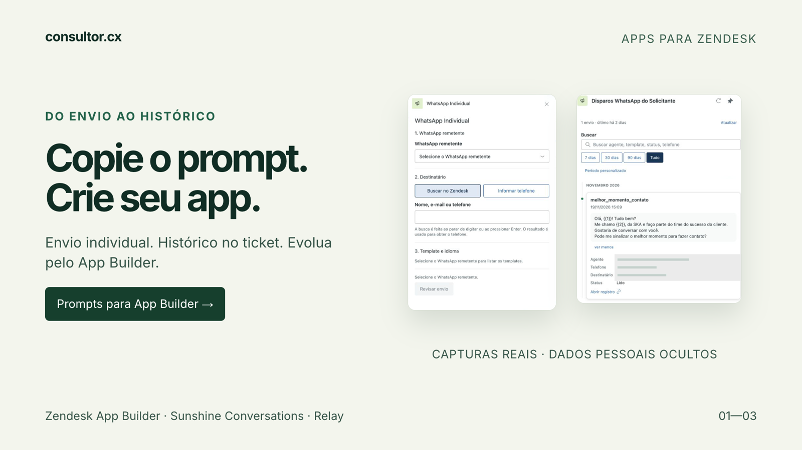
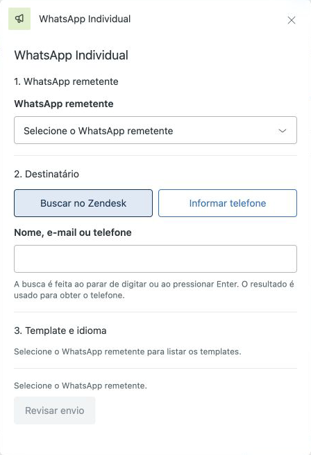
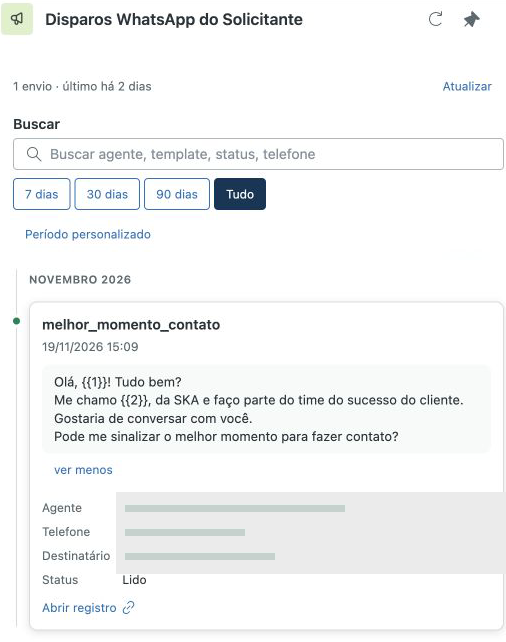
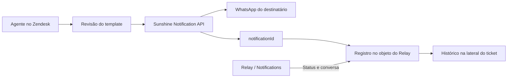

# WhatsApp no Zendesk: envio individual de templates e histórico no ticket

**Faça contatos proativos pelo WhatsApp sem sair do Zendesk — e mantenha o contexto dos disparos disponível para quem atende.**

O **WhatsApp Individual** permite escolher um canal WhatsApp, buscar um destinatário no Zendesk, preencher as variáveis de um template aprovado e revisar a mensagem antes do envio. O app complementar **Disparos WhatsApp do Solicitante** mostra o histórico na lateral do ticket, com busca e filtros de período.

Este repositório compartilha os **prompts completos para criar os dois apps no Zendesk App Builder**, os pré-requisitos do Relay e a documentação técnica da implementação.

[Copiar o prompt do app de envio](prompts/01-app-whatsapp-individual.txt) · [Criar o histórico no ticket](prompts/02-app-disparos-sidebar.md) · [Ver pré-requisitos](docs/01-pre-requisitos.md) · [Falar com Athos](https://consultor.cx)



## Do contato proativo ao contexto do atendimento

Quem trabalha com suporte, relacionamento e Customer Success precisa iniciar conversas e entender o que já foi enviado ao cliente. A proposta é reunir essas duas tarefas no Agent Workspace: preparar o contato pelo app de envio e consultar o histórico no próprio ticket.

| Necessidade da operação | Como os apps ajudam |
|---|---|
| Retomar um contato pelo WhatsApp | Envio individual usando um template aprovado no canal conectado |
| Encontrar o destinatário | Busca por nome, e-mail ou telefone, com alternativa de número manual |
| Personalizar sem editar o texto aprovado | Campos para as variáveis exigidas pelo template |
| Conferir antes de enviar | Prévia de conteúdo e etapa de revisão com confirmação |
| Saber o que foi enviado ao solicitante | Histórico no ticket com template, data, agente remetente e status disponível |
| Adaptar à realidade da equipe | Prompts e documentação para continuar a evolução pelo App Builder |

## Veja os apps em funcionamento


*Motion graphics a partir de capturas reais. Nenhuma mensagem foi enviada para produzir estas imagens. Os dados pessoais foram ocultados; o histórico combina recortes da mesma tela em duas posições de rolagem. A animação apresenta as interfaces, sem simular um disparo ou uma mudança de status.*

### 1. WhatsApp Individual — envie pela barra superior

O agente escolhe o WhatsApp remetente, busca um usuário ou informa o telefone, seleciona um template aprovado, preenche os parâmetros e revisa a mensagem. A confirmação envia uma única solicitação pela Notification API do Sunshine Conversations.

O app contempla variáveis de texto, cabeçalhos com imagem, vídeo ou documento por URL HTTPS e os tipos de botões documentados. Templates incompatíveis continuam visíveis com o motivo do bloqueio. A busca considera os telefones do cadastro e as identidades telefônicas, permitindo escolher quando houver vários números.

<p align="center"></p>

**[Abrir o prompt completo do WhatsApp Individual →](prompts/01-app-whatsapp-individual.txt)**

### 2. Disparos WhatsApp do Solicitante — consulte o histórico no ticket

O segundo app é somente leitura. Ele reúne os disparos encontrados para o solicitante, com nome e conteúdo do template, data e hora, agente remetente, telefone, destinatário e status registrado. A interface tem busca, filtros de período e link para o registro do objeto personalizado.

<p align="center"></p>

**[Abrir o prompt do histórico na sidebar →](prompts/02-app-disparos-sidebar.md)**

O histórico é opcional e usa um app separado. As telas acima mostram os apps instalados; a geração em outra instância precisa ser validada. O código da sidebar não faz parte do ZIP V17 do app de envio.

## Como criar os apps na sua instância Zendesk

1. **Prepare a conta.** Confira [canal WhatsApp, Relay, objetos personalizados, campos e permissões](docs/01-pre-requisitos.md).
2. **Crie o app de envio.** Abra o Zendesk App Builder, inicie um app e cole todo o [prompt em texto puro](prompts/01-app-whatsapp-individual.txt). Ele já inclui os requisitos e o diagnóstico esperado da nova conta.
3. **Configure a conexão.** Preencha `scAppId`, `scKeyId`, `scKeySecret` seguro e `scRegion` com os valores do Sunshine Conversations da própria instância. Não cole credenciais no prompt.
4. **Crie o histórico, se desejar.** Cole o [segundo prompt](prompts/02-app-disparos-sidebar.md) em outro app, na localização `ticket_sidebar`.
5. **Valide antes de liberar para a equipe.** Siga o [roteiro de testes](docs/02-validacao.md), incluindo permissões de um agente comum e um envio controlado autorizado. Depois de publicar, recarregue o Agent Workspace.

**Copiar e colar inicia a construção; a configuração da instância e a validação continuam necessárias.** O App Builder pode gerar implementações diferentes a partir do mesmo prompt.

## Pré-requisitos: Relay e objetos personalizados

A solução usa **Zendesk Messaging com WhatsApp**, **Sunshine Conversations**, **Zendesk App Builder** e **Relay messaging app, do Zendesk Labs, instalado e configurado**. O Relay e os objetos precisam estar prontos na conta de destino.

| Item | O que conferir |
|---|---|
| Objeto de disparos | `zendesk_labs_notifications_campaign_user` |
| Objeto de templates | `zendesk_labs_notifications_template`, com os registros e campos JSON usados no lookup |
| Campo User ID | Lookup para Usuário (`zen:user`), mantendo o título `User ID` |
| Campo Agente remetente | Texto, key `agent_sender`, para o nome e e-mail de quem envia |
| Nome do registro | Numeração automática e compatibilidade dos demais campos obrigatórios |
| Permissões dos agentes | Ler usuários, schemas e templates; criar e editar registros de disparo |
| Autenticação segura | Segredo em parâmetro seguro; scope ZAF `basic_auth_password`; hosts permitidos conforme documentação |

O prompt verifica as pendências previstas, mas não instala o Relay nem migra campos automaticamente. Antes de substituir um campo existente, revise o impacto sobre dados e integrações. O [guia de preparação](docs/01-pre-requisitos.md) explica os detalhes e referencia a [documentação oficial do Relay](https://support.zendesk.com/hc/en-us/articles/7051551958426-Installing-and-using-the-Relay-messaging-app).

## Como o envio e o registro se conectam



Depois da aceitação pela API, o app faz um upsert no objeto de disparos usando **External ID = notificationId**. Grava o telefone enviado, o agente remetente e os vínculos de usuário/template quando identificados. O serviço Notifications deve atualizar status e conversa no mesmo registro; essa correlação precisa ser confirmada na nova conta.

Falha no registro não repete a mensagem. O botão para tentar registrar novamente executa somente essa etapa. O app não grava `notes`, `status`, `conversation_id`, `campaign_id` ou `name`; preserva os campos geridos pelo Relay. Aceitação pela API não comprova entrega ou leitura.

## Perguntas frequentes

### Consigo enviar WhatsApp pelo Zendesk com estes prompts?

Sim. O prompt principal especifica um app de envio individual de templates aprovados, usando o canal WhatsApp conectado ao Sunshine Conversations da conta. O envio depende das credenciais, permissões, disponibilidade das APIs e configuração descritas na documentação.

### Preciso do Relay para usar a solução completa?

Sim. O fluxo documentado de registro e status depende do Relay/Notifications e de seus objetos personalizados. O transporte da mensagem usa Sunshine Conversations; falhas no registro são tratadas separadamente, sem reenviar o WhatsApp.

### Os apps fazem disparos em massa ou campanhas?

Não. O WhatsApp Individual trabalha com **um destinatário por operação**. Campanhas, CSV, agendamento e envio em massa estão fora do escopo.

### O app cria tickets ou altera o roteamento?

Não. Ele não cria nem edita tickets, usuários ou identidades e não altera o roteamento do canal. A escrita prevista é o registro do disparo no objeto personalizado. O atendimento segue a configuração existente da instância.

### O histórico confirma entrega e leitura?

Ele exibe o status disponível no registro, atualizado pelo serviço Notifications. A existência do registro ou a aceitação da notificação não equivale, por si só, a mensagem entregue ou lida.

### Posso continuar evoluindo pelo App Builder?

Sim. Os prompts foram organizados para que o administrador consiga recriar e adaptar a solução. Toda nova geração ou alteração deve passar pela validação da conta; o mesmo texto não garante código idêntico.

## Prompts, referência e validação técnica

| Material | Conteúdo |
|---|---|
| [Prompt do app de envio — texto puro](prompts/01-app-whatsapp-individual.txt) | Bloco completo para copiar e colar |
| [Prompt do app de envio — versão comentada](prompts/01-app-whatsapp-individual.md) | Instruções de uso e diferenças intencionais da V17 |
| [Prompt do histórico no ticket](prompts/02-app-disparos-sidebar.md) | Segundo app, somente leitura |
| [Pré-requisitos](docs/01-pre-requisitos.md) | Relay, schemas, campos, credenciais e permissões |
| [Roteiro de validação](docs/02-validacao.md) | Testes na conta e solução de problemas |
| [Auditoria V17](docs/03-auditoria-v17.md) | Comparação entre post, conversa do App Builder, pacote e GitHub |
| [Pacote V17 original](reference/whatsappIndividual-V17.zip) | Referência preservada; [hash e limites](reference/README.md) |
| [Visuais do README](docs/04-visuais-e-descoberta.md) | Origem das capturas, privacidade e produção da animação |
| [Resumo para ferramentas de IA](llms.txt) | Mapa factual dos principais documentos |

A auditoria inclui **20 cenários locais** sobre o bundle V17, executados sem rede. Eles não substituem testes de interface, autenticação e integração na instância de destino. Para reproduzir, use Node.js 18+ e `unzip`:

```sh
node scripts/verificar.mjs
```

## Quer adaptar ao seu atendimento?

**Athos Alves de Souza · consultor.cx**

Consultoria em Zendesk e experiência do cliente para avaliar a operação e adaptar o fluxo de envio, registro e consulta ao seu contexto.

**[Converse sobre sua operação no consultor.cx →](https://consultor.cx)**

Leia também a [história da criação do app com Zendesk App Builder e o prompt original](https://zendesk.consultorcx.com.br/t/criei-um-app-de-whatsapp-dentro-do-zendesk-com-um-prompt-e-vou-compartilhar-tudo-aqui/962).

*Projeto independente. Este repositório não é um produto oficial da Zendesk ou da Meta. Zendesk, WhatsApp e demais marcas pertencem aos respectivos titulares.*

### English summary

WhatsApp Individual is a Zendesk App Builder project for sending individual approved WhatsApp templates through Sunshine Conversations. A companion ticket sidebar app displays the requester's notification history using Zendesk Labs Relay custom objects. This repository provides reusable prompts, setup requirements and validation guidance; deployment requires account-specific configuration and testing.
