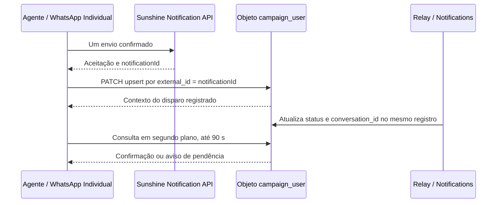

# WhatsApp Individual para Zendesk — prompt completo

Recrie pelo App Builder o app da barra superior: escolha do WhatsApp remetente, busca de destinatários ou telefone manual, templates aprovados, variáveis, prévia, revisão, envio individual e registro no objeto do Relay/Notifications.

**Para começar: copie todo o [prompt em texto puro](prompts/01-app-whatsapp-individual.txt) e cole na primeira mensagem de um novo app do Zendesk App Builder.** Ele já contém os pré-requisitos e as verificações da nova instância. A [versão Markdown](prompts/01-app-whatsapp-individual.md) traz instruções adicionais de uso.

## Preparação e validação

1. Confira [Relay instalado/configurado, objetos e campos](docs/01-pre-requisitos.md). O prompt explica as pendências; não instala o Relay nem migra campos automaticamente.
2. Cole o prompt principal em um novo app `top_bar`. Configure `scAppId`, `scKeyId`, `scKeySecret` seguro e `scRegion` da própria instância.
3. Verifique o diagnóstico de schema, autenticação, remetentes, templates e destinatários. Para o segredo, o scope ZAF correto é **`basic_auth_password`**.
4. Quando decidir publicar, recarregue o Agent Workspace: Cmd+Shift+R no Mac ou Ctrl+Shift+R no Windows/Linux.
5. Execute o [roteiro de validação](docs/02-validacao.md) com destinatário e mensagem de teste autorizados. A correlação assíncrona do Relay só fica comprovada nessa etapa.

Os dois ajustes de campo mais importantes são **User ID como lookup para Usuário (`zen:user`)**, preservando o título `User ID`, e **Agente remetente**, key `agent_sender`, tipo Texto. O app não grava `notes`, pois esse campo era sobrescrito pelo Notifications no histórico da referência. Um PATCH de upsert exige permissão de **criar e editar** registros.

## Fluxo do registro



Aceitação não comprova entrega. Falha de registro nunca repete a mensagem; o botão de retry executa apenas o registro. O app preserva `status`, `conversation_id`, `campaign_id`, `notes` e `name`. Não cria tickets, usuários, campanhas ou templates, nem altera roteamento.

## O que foi auditado

Comparação do repositório com o [post original e seu prompt](https://zendesk.consultorcx.com.br/t/criei-um-app-de-whatsapp-dentro-do-zendesk-com-um-prompt-e-vou-compartilhar-tudo-aqui/962), a exportação de 25 mensagens do App Builder e o pacote V17 fornecido. O [relatório de auditoria](docs/03-auditoria-v17.md) distingue evidência de código, relatos históricos, correções no prompt e testes ainda pendentes.

O [ZIP V17 original](reference/whatsappIndividual-V17.zip) está preservado para comparação, com [hash e limites](reference/README.md). O prompt inclui melhorias explicitadas na auditoria; gerar novamente não garante código idêntico nem dispensa preparar e validar a conta. Não foi feita homologação em outra instância nesta revisão.

Verificação local, sem rede, com Node.js 18+ e `unzip`:

```sh
node scripts/verificar.mjs
```

## App complementar opcional

O [prompt da sidebar “Disparos WhatsApp do Solicitante”](prompts/02-app-disparos-sidebar.md) cria um **segundo app**, somente leitura, para o histórico do solicitante no ticket. Ele já existia neste repositório e não é necessário para o app principal. Seu código não foi fornecido no pacote V17, portanto sua implementação precisa de validação própria.

---

Athos Alves de Souza — [consultor.cx](https://consultor.cx)
